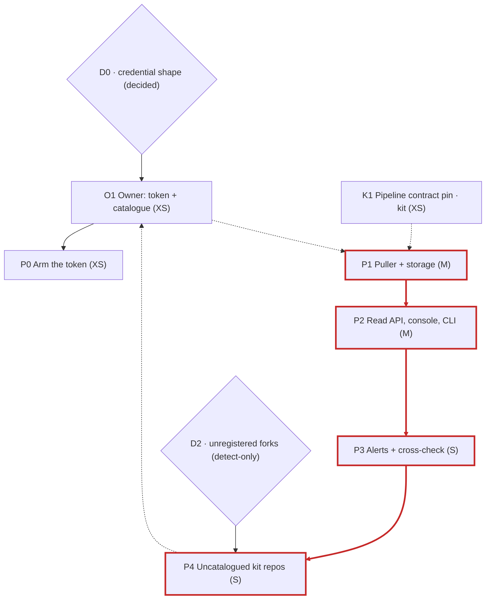

# Deploy Ledger — the fleet registry pulls every deploy from GitHub (phased plan)

The App Registry (`app-registry.cialdnb.ai`, the fleet manager) learns about a deploy today only
by accident: once a day, at 03:00 UTC, each app self-reports the build sha it is running, and the
registry diffs that against the previous report to write one `deploy` row in its Changes feed.
That is a trace, not a log — at most one row per app per day, stamped at report time rather than
deploy time, with no actor, no pull request, no outcome and no duration. A failed deploy never
appears, a deploy and a revert inside one day are invisible, and the trace exists only for the
Workers that carry the `REGISTRY_TOKEN` secret.

This plan replaces the trace with a **pulled deploy ledger**: the registry reads each catalogued
repository's GitHub Actions runs with one read-only token it holds, and records every staging and
production deploy that ran through the kit's two pipelines — shipped, failed, refused or cancelled
— with who started it, which commit, when, how long it took, and a link to the run. **Nothing is
pushed from the forks and no fork changes a line to be covered.** That property is the whole
design, and the numbers below are why.

> **Decided:** pull, not push (owner, 2026-10-12). D0 — a second, per-Worker token (owner,
> 2026-10-12). **v2 (2026-10-13)** folds in a max-effort review of this plan (PR #277: 97 candidate
> findings, 44 survived verification) and a read of the registry's code at `origin/main`. What
> changed from v1 is listed at the end.

## The facts this plan stands on

Measured 2026-10-12 (Workers, registry rows) and 2026-10-13 (repositories), read-only.

| What | Measured |
|---|---|
| Workers on the CIAL account checked for `REGISTRY_TOKEN` (fork and registry, staging and production) | 30 |
| Of those carrying it, so reporting at all | 5: three fork production Workers (`product`, `consumption-statement`, `app-pay-management`) and the registry's own pair |
| Fork **staging** Workers reporting | 0 |
| `deploy` rows in the registry, fleet-wide, ever | 6, from two apps |
| Since the fleet token was wired | about two months (2026-08-05) |
| Active repositories in the CialDNB org | 612 |
| Of those carrying both kit deploy workflows ("kit-shaped") | 21 |
| Kit-shaped repositories the catalogue knows | 12 |
| Kit-shaped repositories with **no catalogue row** | 9: eight app repositories (`arena-go`, `binui-projects`, `cv-screener`, `db-talents`, `dnbnews`, `elos`, `il-Lingua-paved`, `insights`) and `paved-road`, the kit's GitHub template repository (`is_template`), which is never an app and which P4 leaves out |
| Catalogued repositories that are not kit-shaped | 2: `Arena-2` (Arena 2) and `cial_arena` (Arena). The pull still reads them, because it reads every catalogued CialDNB repository. It records no deploy from them, and backs off daily a workflow file a repository lacks |

Two months of a per-Worker secret step produced reporting from three fork production Workers out
of 28 fork Workers. Any design that needs a per-fork secret — including "push a deploy event from
CI" — inherits that curve. Pulling from GitHub needs exactly one credential, held by the registry.

**What GitHub already knows**, verified on `CialDNB/product`: a workflow run exposes the triggering
actor, the head sha, the head commit (whose first line carries the PR number under the kit's
squash-merge convention), the attempt number, the outcome, start and end times, and a link. Its
jobs expose a status, a conclusion, timing, and every step with its own conclusion. A run's
`display_title` is **not** the commit title: it is the workflow name ("Deploy production") on every
`workflow_dispatch` run and is cut to about 70 characters on push runs.

## Coverage, stated precisely

The ledger records deploys that **run through the two kit pipelines** of a **CialDNB** repository a
catalogue row names, and that an hourly pull sees. Everything else escapes it. Each bound below is
stated in P1's code (`src/cron/deployPull.ts`, its THE PULL SET and BOUNDS comments):

- **Deploys outside the pipelines.** `npm run deploy` and `npm run deploy:staging` from a laptop,
  and `wrangler rollback`, leave no Actions run, so the ledger cannot list them. P3's
  `deploy_not_running` can flag one after the fact, because it fires when the build an app reports
  is not the newest build CI shipped. But it is evaluated on the daily **self-report**, so it covers
  only the Workers that self-report: 5 of 30 when measured (three fork production Workers and the
  registry's own pair, no fork staging Worker). On every other Worker an out-of-band deploy stays
  invisible until `REGISTRY_TOKEN` coverage improves.
- **An attempt superseded within the hour.** GitHub's runs list reports only a run's latest
  attempt. If a deploy fails and is re-run before any hourly pull has seen the failed attempt, only
  the re-run is recorded, and the ledger shows no failure.
- **Repositories outside the CialDNB org.** The pull reads only repositories the CialDNB org owns
  (`DEPLOY_LEDGER_OWNER`). A catalogue `repo_url` under any other owner, such as a personal fork or
  another org, is counted as `out_of_org` and never read, so that app's Deploys panel stays empty.
- **The newest page only.** Each pull reads the newest 20 runs of each workflow. A first pull starts
  the ledger from that page and does not backfill. If a workflow runs more than 20 times between two
  pulls, the overflow is lost. A re-run of a run that has fallen off that page is not seen.
- **The retention horizon.** A deploy older than 400 days is never written, so the first pull of a
  long-quiet repository starts the ledger at the horizon.

## What this is NOT

- Not a replacement for the daily self-report. The self-report carries health, migrations and the
  governance manifest; this ledger carries deploys. The self-report's `deploy` change row stays,
  and P3 turns the pair into a cross-check: "CI shipped sha X; the Worker says it runs Y".
- Not real-time. The pull runs hourly; GitHub's own Actions page is where to watch a deploy land.
  The ledger answers "what shipped across the fleet, by whom, and did it work".
- Not a second registration path. The registry already creates a catalogue row by machine when an
  app first self-reports, with governance fields at their schema defaults for a human to triage.
  P4 adds **detection** of kit repositories that never reported; it writes nothing (D2).

## The pipeline contract the ledger reads

| Env | Workflow file | Job (the API `name`) | Ship step | Trigger |
|---|---|---|---|---|
| staging | `.github/workflows/ci.yml` | `deploy-staging` | `Deploy to staging` | push to `main` (every squash-merge) |
| production | `.github/workflows/deploy-prod.yml` | `deploy` | `Deploy to production` | `workflow_dispatch` on `main` |

This table is a summary. The contract has **one full statement**: docs/MANIFEST.md "Deploys the
registry pulls", pinned by `test/platform/deploy-ledger-contract.test.mjs` (both added by K1,
#278). That statement also covers the migrations steps the outcome classification reads and what
must stay absent so the Actions jobs API keeps reporting the job id as the job's display name. A
change to the contract is made there, not here. A `deploy-staging` job that concludes `skipped` is
the `DEPLOY_ENABLED` gate being off or an upstream gate failing — not a deploy, never recorded.

**What the pin covers.** The pin covers the kit, and every fork created from it after #278 lands.
`/kit-upgrade` does not carry the test, so the workflows of an **existing** fork stay unpinned.
The registry cannot tell such a fork's drift from a quiet fork. A completed run with no job of the
pinned name maps to "did not deploy" and is cached as settled. A deploy job without a step of the
ship step's name records `shipped` as NULL. Neither raises a finding, an alert or a log line that
names the cause. So a fork that renames its deploy job, or adds a job-level `name:` to it, drops
out of the ledger silently. Closing that gap is O1's third item.

## The design (P1)

**What is pulled, and how often.** A registry cron task, `deploy_pull`, runs hourly on its own cron
expression (`17 * * * *`, dispatched explicitly: `0 * * * *` is the audit watch, and an expression
the dispatcher does not recognise falls back to the whole daily ops loop). It takes the distinct
GitHub repositories behind the catalogue's `repo_url`s — normalised to a lowercase `owner/name` and
pulled once however many catalogue rows point at them — and lists the newest page of runs of both
workflows (production from `main` only; the kit guard refuses any other ref). Both wrangler configs
carry the expression, so staging pulls before production does.

**Cheap by construction.** List calls send `If-None-Match` with the stored ETag, and a `304` costs
nothing against GitHub's rate limit. A run attempt's jobs are fetched once: a small run cache
remembers completed attempts, including the ones whose deploy job was skipped. A repository that
404s or has moved is re-checked at most daily. Each invocation stops at a fixed request budget and
when the rate-limit headroom drops below a floor, and repositories are visited oldest-pull-first so
a budget cut rotates rather than starves the same ones. Renamed repositories answer `301`; the
client follows exactly one redirect, and only to `https://api.github.com`, so the token is never
sent anywhere else.

**The token.** `GITHUB_ACTIONS_TOKEN`, a fine-grained token with `Actions: read` and
`Metadata: read`, held as a **per-Worker secret** — the kit's rule for a secret only one app uses
(docs/SECRETS.md), and the mechanism the registry's own `GITHUB_TOKEN` already moved to. There is
**no fallback** to `GITHUB_TOKEN`: that token is deliberately scoped without `Actions`, so a
fallback could only ever 403, and a fail-quiet client would turn that into an empty ledger that
looks healthy. Without the token the pull is a no-op that says so. `Actions: read` is **not**
metadata-only: on every repository the token can see, it can also download run logs and artifacts.
The pull never fetches them; that reach is the token's blast radius, and its repository scope is
an owner choice (O1). A fine-grained token's rate limit is the minting user's, shared with that
user's other tokens.

**The row** (`deploy_events`, one per deploy-job attempt, keyed on the repository, the run, the
attempt and the job — never on a catalogue app id, so twin catalogue rows cannot double-record a
deploy and no rebuild of `apps` can cascade-wipe the ledger): repository, env, workflow, run id, run
attempt, job id, full sha, the triggering GitHub login, trigger event, title (the head commit's
first line, capped), PR number, status, `shipped`, GitHub's raw conclusion, start, finish,
duration, run link, observed and updated times. Timestamps use the registry's SQLite UTC format,
like every other table, so they compare correctly with `app_status.reported_at`.

**Outcome from the steps, not the job alone.** A failed production job can mean "refused, nothing
shipped" (the main-only and `DEPLOY_ENABLED` guard, preflight, tree verification, scans) or
"shipped, then the smoke check failed". The classification reads the job's steps: `shipped` is 1
when the ship step succeeded, 0 when it failed or never ran, and NULL when no step carries the ship
name (a fork renamed it — then the job-level mapping applies and nothing is guessed). `status` is
one of `queued`, `waiting` (a production deploy held for the required reviewer), `in_progress`,
`success`, `failure`, `cancelled`, or `refused` — a completed job that stopped before any step that
touches production (migrations or the ship step). A staging job that never started a step (a
superseded run on `main`) is not recorded; a production one (cancelled while waiting for approval)
is recorded as `refused`.

**Re-runs.** A re-run keeps the run id and creation time but gets a new attempt number, so it is a
new row, and the earlier attempt stays as history **when a pull saw it** before the re-run
superseded it. Jobs are read per attempt. An attempt superseded before any pull saw it, and re-runs
of a run that has fallen off the newest page, are not seen (see Coverage).

**The PR.** A staging deploy's PR number comes from the `(#123)` suffix of the squash-merge commit.
A production run is a manual dispatch with no PR of its own, so it inherits the PR of the staging
deploy of the same sha.

**Liveness.** An expired, revoked or under-scoped token must not leave the ledger quietly empty.
Each pull run records its fleet-level outcome, and the daily fleet digest carries one finding when
the token is set and the newest run was refused by GitHub, or no run has completed in 24 hours.

**Identity, retention and logs.** The deployer's GitHub login is stored, because "who shipped it" is
a deploy ledger's job and every org member can already see it on GitHub. It is staff identity data,
classified like `audit_log.actor_email` in the registry's data classification and PIA, and
readable only with `activity.read` (owner, admin). Rows are pruned at 400 days, like the registry's
other derived ledgers; the run cache at 30. Logs carry counts and outcome categories only — never a
login, repository, sha, title or URL. (The registry runs kit 0.2.1, which logs through `console`;
it has no `logEvent` registry yet.)

## Phases

Sizes are structural (surface area, tests, decisions), never wall-clock. "Ships standalone" means
independently testable, mergeable and revertable.

### P1 — Puller + storage (registry, M) — ships standalone

- **Deliverable:** migration `0016` + `schema.sql` (`deploy_events`, the run cache, per-repository
  pull state), a `deploys` repository in `src/data/`, `listWorkflowRuns` and `listRunAttemptJobs`
  in `src/integrations/github.ts`, the `deploy_pull` task on its own hourly expression in both
  wrangler configs, the `GITHUB_ACTIONS_TOKEN` field in `src/env.ts`, the liveness finding, the
  prune, a registry DECISIONS entry, and the data-classification and PIA rows.
- **Alongside:** the registry's existing secrets reconcile passes `redirect: 'error'`, which the
  Workers runtime rejects with a `TypeError` ("use `manual` and check the response status code"),
  so it fails on every production call while its fake-fetcher tests pass. P1 routes it through the
  new request helper, in its own commit.
- **Tests (~30):** every integration failure reason and the 304 path; the status, `shipped` and
  `refused` classification from synthetic steps; idempotent upserts and re-run attempts; twin
  catalogue rows pulled once; budget, rate-limit floor and back-off; liveness; prune; cron
  dispatch; the migration; no identifier in any log line.
- **Merge order:** open registry PRs #81 and #82 (another workstream; #82 is stacked on #81) also
  claim `0016` and `0017`, and both rebuild the same `alert_rules` kind CHECK P3 widens. Whichever
  lands later renumbers; P1 adds a test that fails CI until migration numbers are unique and
  contiguous.

### P0 — Arm the token (registry, XS) — merges only after the owner sets it

- **Deliverable:** `GITHUB_ACTIONS_TOKEN` in `secrets.required` in `wrangler.jsonc` and
  `wrangler.staging.jsonc`, the docs/SECRETS.md row (scope, blast radius, the repository-scope
  choice, how to set it), `.dev.vars.example`.
- **Why separate:** `secrets.required` fails a deploy when the secret is missing, and the registry
  deploys staging on every merge. So P0 waits for O1's token, and P1 does not wait for P0 — P1 is
  dormant until the secret exists.

### P2 — Read API, console, CLI (registry, M) — after P1

- **Deliverable:** `GET /api/deploys` (fleet-wide, the registry's naming for fleet routes) and
  `GET /api/apps/:id/deploys` (`activity.read`, uniformity fixture); pulled deploys on the Changes
  page beside the self-reported rows with a provenance label (*GitHub Actions* versus
  *self-report*), `refused` shown as "nothing shipped" and a shipped-then-failed deploy shown as
  such; a Deploys panel on the app; `npm run ledger -- deploys`.
- **Tests (~15):** both routes incl. uniformity and the permission matrix, the API mirror pin, the
  CLI, the console view.

### P3 — Alerts and the running-sha cross-check (registry, S) — after P2 (as built; planned after P1)

- **Deliverable:** two seeded fleet-wide alert kinds. `prod_deploy_failed`: a production deploy
  ended `failure` or `cancelled` — not `refused`, which shipped nothing, unless the rule's
  `include_refused` is set (off by default) — evaluated by the pull,
  and only when observed within 24 hours of finishing, so a first-pull backfill or a late-registered
  repository never turns months-old failures into new alerts. `deploy_not_running`: the build an
  app reports does not match the newest CI deploy that **shipped** for that env and finished before
  the report (evaluated on ingest; prefix match, since production reports a short sha and staging
  the full one; it names both causes — the deploy did not take effect, or something was deployed
  outside CI). Staging failures show in the console and do not alert by default.
- **Migration care:** `alert_rules.kind` carries a CHECK, so adding kinds rebuilds the table, and
  `alert_events` cascades from it — the migration stashes and restores `alert_events`, following the
  registry's own precedent (`0003`). Open registry PRs #81 (`write_volume`, `backup_stale`) and #82
  (`db_growth`, `table_size`, `log_share`) rebuild the same CHECK. Whichever of the three rebuilds
  lands last must list the union of **every** kind set — the base six, #81's two, #82's three and
  P3's two — in its CHECK and in `schema.sql`. A rebuild that omits a kind fails at its
  `INSERT … SELECT` on the seeded rows of that kind, and since both pipelines apply D1 migrations
  before `wrangler deploy`, the staging and production deploys go red.
- **Tests (~12):** fire and no-fire per rule incl. the grace and observation windows and the prefix
  rule; the rebuild keeps every alert event; seed idempotence; digest wording.

### P4 — Detect kit-shaped repositories missing from the catalogue (registry, S) — after P3 (as built; planned after P1)

- **Deliverable:** a rolling, budgeted scan of the org's repositories — 612 active, so no single run
  can visit them all. Never-scanned and recently-pushed repositories go first; each run stops at its
  budget. A repository carrying both kit workflows that no catalogue `repo_url` resolves to (through
  the same normalisation as P1) becomes one finding in the existing fleet digest, on the day a new
  one appears and weekly as a reminder. Detect-only (D2).
- **Tests (~10):** classification, rotation and budget, fail-quiet, the finding's wording and
  cadence, no catalogue writes.

### K1 — The pipeline contract, pinned in the kit (kit, XS) — ships standalone

- **Deliverable:** the contract's one full statement in docs/MANIFEST.md ("Deploys the registry
  pulls"), naming the registry as the consumer, and a platform test that pins it, with self-tests
  that make it fail on each violation. The contract's DECISIONS entry ships with this plan and
  points at those two.
- **Reach:** the kit, and forks created after it lands. Existing forks get neither the test nor
  the pin until O1's third item is decided (see "What the pin covers").

### O1 — Owner actions (not code)

1. **Mint the token**: a fine-grained token (`Actions: read`, `Metadata: read`, read-only, with an
   expiry you track). Choose its repository scope:
   - *All repositories.* P4 needs this to find kit repositories nobody catalogued. The log and
     artifact reach then covers all 612.
   - *Only select repositories.* The exposure is narrower, but the selection must cover **every
     CialDNB repository a non-retired catalogue row names**, kit-shaped or not (today that includes
     `Arena-2` and `cial_arena`), plus `app-registry` and `paved-road`. Each app catalogued later
     must be added too. A catalogued repository the token cannot see is stored as `invisible` and
     retried every hour, not backed off. Every daily fleet digest then reports "N catalogued
     repositories the token cannot see" until the token covers it or its row is retired. P4 sees
     only the selected repositories.

   **Set it only through the checked sequence in app-registry `docs/SECRETS.md`** (P0, #87). That
   sequence refuses anything that is not a fine-grained `github_pat_` token. It probes
   `app-registry` and `paved-road` and stores nothing unless both answer `200`. Then it puts the
   token with `--name` on both `app-registry` and `app-registry-staging`. Never use a bare
   `wrangler secret put`: it stores whatever it receives, an empty value included, and the pull
   reads an empty value as unset. The ledger would then stay silent with nothing reporting it.
   Then merge P0.
2. **Register** the eight kit-shaped app repositories the catalogue is missing, with their
   `repo_url`. `paved-road` is the ninth uncatalogued kit-shaped repository, but it is the kit's
   template and never an app, so it gets no catalogue row (P4 leaves templates out).
3. **Decide how the contract pin reaches existing forks.** Today it does not reach them (see "What
   the pin covers"), and a fork whose workflows drift drops out of the ledger silently. There are
   two options, and they combine:
   - carry `test/platform/deploy-ledger-contract.test.mjs` through `/kit-upgrade`. That edits the
     protected `kit-upgrade` skill and its plugin mirror, in a PR of its own;
   - have the registry detect drift itself, since it already reads every fork's runs. It would raise
     a digest finding when a successful `main` run of `ci.yml` or `deploy-prod.yml` has no job of
     the pinned name, or when a deploy job lacks the ship step. That covers every fork at any kit
     version. It is registry work and is not built in P1–P4.

## Decision points

- **D0 — decided 2026-10-12 (owner):** a second token, per-Worker. *Rejected:* widening
  `GITHUB_TOKEN` with `Actions: read`; a Secrets Store binding (the store is for fleet-shared
  secrets and capped at 100 for the account).
- **D2 — unregistered forks:** detect-only, taken as the recommended default during implementation.
  *Alternative the owner can still choose:* auto-create a catalogue row with `repo_url` filled; its
  governance fields would get the schema defaults (`sensitivity` none, `risk` low) for a human to
  triage, exactly like a first self-report. Additive to P4, not a rewrite.
- **Token repository scope (O1):** all repositories, or a selection. This is a security choice for
  the owner at minting time. A selection must cover every CialDNB repository the catalogue names,
  kit-shaped or not, plus `app-registry` and `paved-road`. A catalogued repository it misses is
  retried hourly and named in every daily digest as one the token cannot see. A selection also
  limits P4 to the repositories it covers.

## Rejected (so the trade-offs are on record)

- **Push from CI.** Needs a per-fork secret; the measured coverage curve for exactly that kind of
  step is three fork Workers in two months.
- **The GitHub Deployments API as the primitive.** Staging is not in it until every fork adopts an
  `environment: staging` line through `/kit-upgrade`, and it records attempts: the two production
  deployments `product` shows for one sha are a failed attempt and its re-run — which the ledger
  records as two rows of one run when a pull saw the first attempt before the re-run.
- **Rows keyed on a catalogue app id.** One repository can back several catalogue rows; keying on
  the app double-records deploys and ties the ledger to `apps` rebuilds.
- **A creation-time watermark.** Re-runs keep their creation time, so a watermark misses them.
- **A fallback to `GITHUB_TOKEN`.** It has no `Actions` scope by design; the fallback could only
  fail silently.
- **Outcome from the job conclusion alone.** It cannot tell a guard refusal from a failed ship, so
  alerts would fire on deploys that never touched production.
- **Committing the executor skeletons to the kit.** `/kit-upgrade` carries `.claude/` and
  `biome.json` to every fork, these scripts are registry-specific, they needed a lint carve-out,
  and the kit's 2026-08-05 decision is to ship no workflow script. The graph below stays; the
  scripts drove one execution and live outside the repository.
- **Daily cadence.** Free, but turns "every deploy" into "yesterday's deploys".

## Where the work runs

K1 and this document live in the kit. P0–P4 are `app-registry` code on their own branches. The
registry's CI runs only on pull requests into `main`, so every PR targets `main`. P1–P4 form one
linear stack: each later PR is built on its predecessor's branch and names that predecessor in its
description (P2 on P1, P3 on P2, P4 on P3; see As built). P0 stands apart. Nothing merges or
deploys without the owner. O1 is the owner's.

## As built (2026-10-14)

Every phase is implemented, reviewed and open as a PR. Nothing is merged or deployed.

| Phase | PR | Migration | Lands |
|---|---|---|---|
| Plan + contract decision | CialDNB/paved-road#277 | — | any time |
| K1 contract pin | CialDNB/paved-road#278 | — | any time |
| P1 puller + storage | CialDNB/app-registry#88 | `0016_deploy_ledger` | first |
| P2 read API, console, CLI | CialDNB/app-registry#89 | `0017_deploy_repo_aliases` | after #88 (once it carries #88's head; see Landing the stack) |
| P3 alerts + cross-check | CialDNB/app-registry#91 | `0018_deploy_alert_rules` | after #89 (carries it) |
| P4 uncatalogued kit repositories | CialDNB/app-registry#90 | `0019_fleet_repo_scan` | after #91 (carries it) |
| P0 arm the token | CialDNB/app-registry#87 (draft) | — | after the owner sets the secret on both Workers; either order with the stack |

Where the build departed from the phases above, and why:

- **A linear stack, not three siblings.** P2, P3 and P4 each needed a migration, and P1 added a test
  that keeps migration numbers unique and contiguous. Siblings each taking `0017` cannot all pass
  it, so P3 carries P2 and P4 carries P3, and the numbers run `0016`–`0019`. The combined stack
  passed the full gate, and the four migrations replay identically on a fresh install and on a
  database shaped like production. That gate ran on the stack built on P1 at `39c5928`. P1's last
  two commits (`545f4cb`, `67ac171`) are test-only and came after: the oldest-pull-first rotation
  test and the daily back-off test. When this was written, #89, #91 and #90 did not carry them.
  A dry-run merge of P1's head into #89 is clean.
- **P2 also handles renamed repositories.** Review found that a GitHub rename splits a
  repository's history between two spellings, so P2 adds a small name map (`deploy_repo_aliases`,
  written by the pull) and joins both names on read. That makes P2 touch the pull and the data
  layer, not only routes and the console.
- **K1 pins more than the plan named.** It also pins the `Apply Supabase migrations` step, which
  the registry treats as able to touch the environment, and production's main-only guard. It also
  pins absences the plan did not list, such as no matrix or reusable-workflow call at job level and
  no `on: workflow_call` trigger. docs/MANIFEST.md "Deploys the registry pulls" has the full list;
  this plan does not repeat it. Existing forks do not get the test (#278).
- **P1 pulls, and P4 scans, the CialDNB org only**, the owner the token is minted for, rather than
  every owner found in the catalogue. A catalogue `repo_url` under another owner is counted as
  `out_of_org` and never read, so that app's Deploys panel stays empty (see Coverage). The reason:
  a fine-grained token also reads every public repository on GitHub, and `repo_url` is free text.
  An outside URL would spend the token owner's rate limit every hour, and could write the logins of
  people who are not CIAL staff into the ledger.
- **Fixed alongside in P1:** the registry's existing secrets reconcile, which used a redirect mode
  the Workers runtime rejects.
- **Outside this stack:** open registry PRs #81 and #82 (another workstream; #82 is stacked on #81)
  also claim `0016` and `0017`, and **both** rebuild the same `alert_rules` kind CHECK: #81 in
  `0016_alert_rules_add_growth_kinds` and #82 in `0017_storage_history_and_growth_rules`.
  Whichever lands later renumbers (the numbering test keeps CI red until it does), and the rebuild
  that lands last lists the union of all of them: the base six kinds, #81's and #82's five, and
  P3's two (`prod_deploy_failed`, `deploy_not_running`). P3's `0018` header says the same.

### Landing the stack

The kit squash-merges, so a PR's commits never reach `main` as themselves. After #88 lands as one
squashed commit, merging `main` into #89 is an add/add merge. A dry run conflicted in 13 files
(#90: 20), including `deployPull.ts`, `deploys.ts`, `schema.sql` and the pull's tests. Taking the
branch side, which is the natural move because the branch looks like a superset, silently drops
anything the predecessor gained after the branch was built. CI stays green, so nothing reports the
loss. To land each PR in order:

1. **Before the predecessor lands**, merge its head into the next PR, and from there up the stack
   (P1's head into #89, #89 into #91, #91 into #90). Confirm each with
   `git merge-base --is-ancestor <predecessor head> <branch>`. Once that holds, the branch really
   is a superset of its predecessor.
2. **After the predecessor squash-merges**, merge `main` into the next PR. Resolve each conflict
   by keeping both sides' content. Do not take the branch side wholesale. Then check that
   `git diff <predecessor head> HEAD -- test/` deletes nothing the predecessor added, and re-run
   the full gate.
3. **CHANGELOG and DECISIONS** conflict on every landing, because each PR adds an entry at the
   top. Keep every entry, newest on top.

P0 (#87) and P1 both edit `wrangler.jsonc`, `wrangler.staging.jsonc`, `CHANGELOG.md` and
`docs/DECISIONS.md`. Only the last two conflict textually with the stack: the wrangler configs
merge cleanly, because P0 changes `secrets.required` and the stack changes only the cron triggers
line. Whichever of P0 and the stack lands second merges `main` and keeps both entries.

---

## Dependency graph (`/plan-to-graph`, re-derived from the as-built stack, 2026-10-19)

v2 planned P2, P3 and P4 as siblings of P1. The build made them a linear stack (see As built), so
this graph follows the stack, not the original phase text.

### Nodes

| id | Name | Size | Ships standalone | Key deliverable |
|---|---|---|---|---|
| P1 | Puller + storage | M | yes | `deploy_events` + run cache + pull state, runs/jobs calls, step-based outcome, hourly `deploy_pull`, liveness, prune, ~30 tests |
| P0 | Arm the token | XS | yes, after O1 sets the secret | `GITHUB_ACTIONS_TOKEN` in `secrets.required` (both configs), SECRETS.md row and checked set sequence |
| P2 | Read API, console, CLI | M | after P1 | `GET /api/deploys`, `GET /api/apps/:id/deploys`, Changes-page rows + app panel, `ledger deploys`, the repository name map, ~15 tests |
| P3 | Alerts + cross-check | S | after P2 | `prod_deploy_failed` + `deploy_not_running`, the `alert_rules` rebuild that keeps `alert_events`, ~12 tests |
| P4 | Uncatalogued kit repositories | S | after P3 | rolling, budgeted org scan → one fleet-digest finding, detect-only, ~10 tests |
| K1 | Pipeline contract pin (kit) | XS | yes | platform test pinning the contract in docs/MANIFEST.md "Deploys the registry pulls" |
| O1 | Owner actions | XS | n/a (not code) | mint + scope the token, set it on both Workers through the checked SECRETS.md sequence; register the eight missing kit app repositories; decide how the contract pin reaches existing forks |
| D0 | Decision: credential shape | — | — | **decided 2026-10-12:** a second, per-Worker token |
| D2 | Decision: unregistered forks | — | — | detect-only, taken as the recommended default |

### Edges

**Hard** (must land before the target merges):

- `P1 → P2 → P3 → P4`. Each PR carries its predecessor's commits and takes the next migration
  number (`0016`–`0019`), and the numbering test fails on a gap or a duplicate (As built).
- `O1 → P0` (merge order). P0 waits for O1's token, because `secrets.required` fails a deploy when
  the secret is missing, and every merge to `main` deploys staging.
- `D2 → P4`. P4 implements the D2 choice.

**Soft** (informs, does not block):

- `K1 ⇢ P1`. K1 pins the names P1 matches on.
- `O1 ⇢ P1`. P1 is dormant until the token exists, and covers only catalogued repositories.
- `P4 ⇢ O1`. P4's finding tells the owner what to register.

P0 and the stack share four files (both wrangler configs, `CHANGELOG.md` and `docs/DECISIONS.md`).
They merge in either order, and whichever lands second resolves the CHANGELOG and DECISIONS
conflicts (Landing the stack).

### Critical path (hard edges only)

`P1 (M) → P2 (M) → P3 (S) → P4 (S)`. The owner's token (O1) gates when the ledger starts filling,
not when the code can merge.

### Waves

| Wave | Nodes | Max parallelism | Notes |
|---|---|---|---|
| 1 | K1, P0, P1, O1 | 4 (3 code + 1 owner) | P0's PR is open as a draft and merges after O1 |
| 2 | P2 | 1 | lands after P1, carrying P1's head |
| 3 | P3 | 1 | lands after P2, carrying it |
| 4 | P4 | 1 | lands after P3, carrying it |

### Flowchart

Solid = hard, dotted = soft, diamonds = decisions, red = critical path.

---

## What changed from v1

- **Token mechanism:** a per-Worker secret, not a Secrets Store binding (the kit's rule for a
  one-app secret; the registry's own `GITHUB_TOKEN` already moved). P0 is now only "arm
  `secrets.required`", merged after the owner sets the secret; P1 owns the `src/env.ts` field.
- **No fallback** to `GITHUB_TOKEN`, and a stalled or refused pull now raises a daily digest
  finding.
- **Token reach recorded:** `Actions: read` also reaches logs and artifacts; the repository scope is
  an owner choice; the rate limit is the minting user's.
- **Row identity:** keyed on repository, run, attempt and job — not `(app_id, run_id)`. Re-runs are
  new rows; no creation-time watermark; ETag conditional requests instead.
- **Outcome:** read from the job's steps — `shipped`, and a `refused` status for gate refusals —
  plus `waiting`; production runs from `main` only; titles from the head commit, not
  `display_title`.
- **Platform:** a request budget, a rate-limit floor and back-off per invocation; an hourly
  expression of its own, dispatched explicitly; both wrangler configs.
- **Registry facts:** logging through `console` (no `logEvent` yet); the fleet route is
  `/api/deploys`; `alert_rules` needs a rebuild that keeps `alert_events`; open PRs #81/#82 claim the
  same migration numbers; the existing reconcile's `redirect: 'error'` is a runtime error on
  Workers.
- **Retention:** 400 days, with the PIA and data classification updated, instead of never pruned.
- **Alerts:** `prod_deploy_failed` ignores refusals and backfills; `deploy_not_running` compares
  against the newest deploy that shipped, and names an out-of-band deploy as a cause.
- **Facts:** repository counts measured directly (21 kit-shaped, 9 uncatalogued of which one is
  the kit template, 2 catalogued but not kit-shaped); coverage scoped to the two pipelines; the D2
  premise corrected (the registry already self-registers on first report).
- **K1:** pins job display names and step names, not only job ids; it adds no DECISIONS entry.
- **Executor skeletons:** removed from the kit, with the `biome.json` carve-out they needed.
